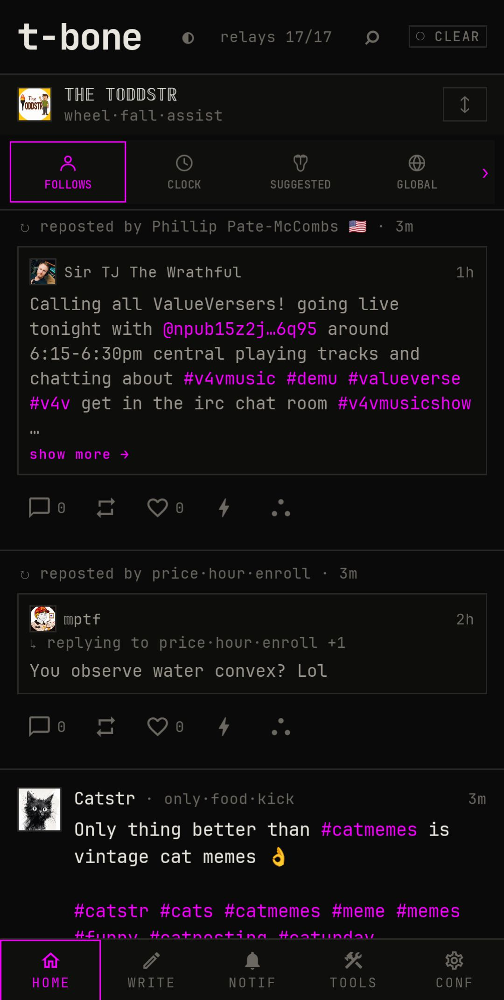
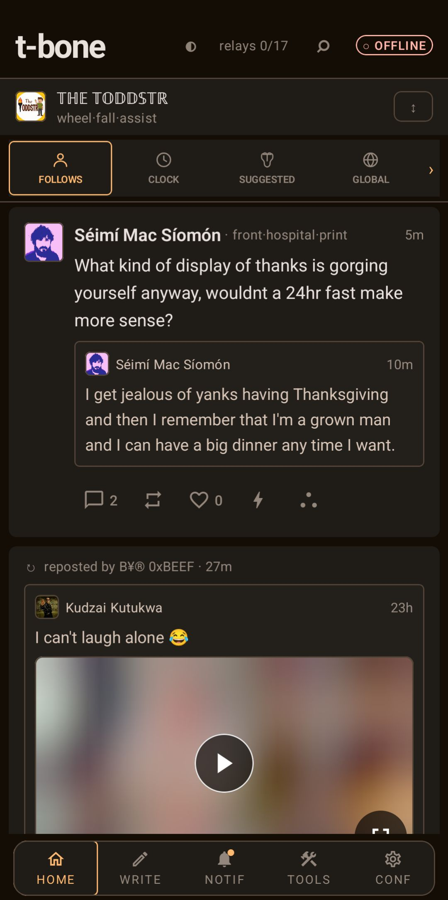
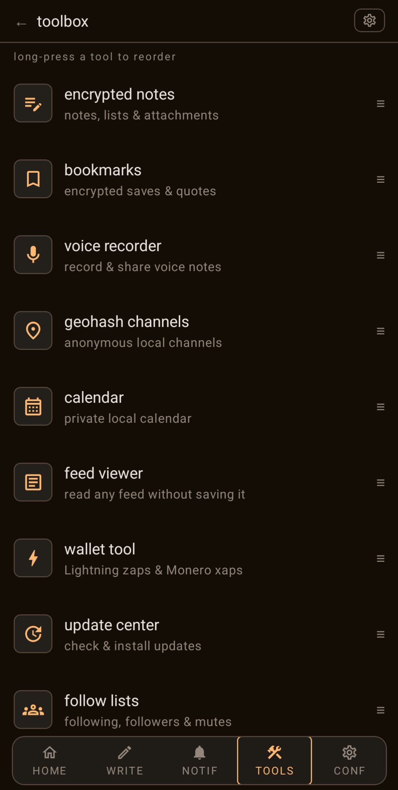

<p align="center">
  
</p>

<h1 align="center">T-Bone for Android</h1>

<p align="center">
  <strong>A lightweight, opinionated Nostr client &amp; encrypted local toolbox for Android.</strong><br/>
  Zero Google Play Services · Zero Firebase · Zero analytics · MIT licensed
</p>

<p align="center">
  <a href="https://zapstore.dev/apps/social.tbone.fork">Install on Zapstore</a> ·
  <a href="https://github.com/toddsmith456/T-Bone-/releases/latest">GitHub Releases</a> ·
  <a href="CHANGELOG.md">Changelog</a> ·
  <a href="docs/PRIVACY.md">Privacy Policy</a> ·
  <a href="docs/nip-compatibility.md">NIP Compatibility</a>
</p>

---

**T-Bone** (`social.tbone.fork`) is a lightweight, opinionated Nostr client for Android — built for people who want their social feed fast, sovereign, and completely free of surveillance.

Most social apps treat you like a data stream: bloated SDKs, engagement algorithms, cloud lock-in, and silent telemetry baked into every screen. T-Bone takes the opposite stance. What began as a minimalist fork has grown into a daily-driver Nostr client and private local toolbox guided by a few firm convictions:

- **Privacy isn't a toggle — it's enforced at build time.** Zero Google Play Services, zero Firebase, zero analytics, and zero tracking endpoints, verified automatically in CI on every PR and release.
- **Your feed should obey *you*, not an algorithm.** Read live Follows, rewind 1–24 hours in Clock mode, browse a curated Suggested roster, or pin your own custom tabs for People lists, relays, hashtags, and polls.
- **Your keys and private data belong on *your* device.** Delegate signing to Amber or a NIP-46 bunker, keep private notes and calendar entries encrypted under Android Keystore, and maintain offline follow/block lists that never touch a relay.
- **Lean underneath, unmistakable on the surface.** Native cryptography and low-overhead rendering keep scrolling snappy — while deep theming lets you go from a razor-sharp monospace terminal look to warm, rounded Youniversal styling with custom accents, fonts, and 18 launcher icons.

<p align="center">
  
  &nbsp;
  
  &nbsp;
  
</p>

---

## Key Features

### Your Feed, Your Rules
- **Four built-in home feeds:**
  - **Follows** — live timeline from your follow list (or your local-only offline follow list).
  - **Clock** — a time-machine window frozen 1–24 hours in the past through the people you follow.
  - **Suggested** — curated roster of 1,300+ Nostr accounts for instant discovery without algorithmic noise.
  - **Global** — live relay firehose with buffered loading and past paging.
- **Custom home tabs:** Add, reorder, or hide tabs backed by **People lists** (manual or synced NIP-51 sets), **specific relays**, **hashtags**, or **NIP-88 polls**.
- **Full Nostr social toolkit:** Threaded replies, reposts and embedded quote notes, NIP-88 polls, customizable emoji reactions, bookmarks & NIP-51 bookmark folders, profile pins, NIP-09 deletions, NIP-56 reports, profile & hashtag search, and branded image/video share cards.
- **Built to stay fast:** Native `libsecp256k1` Schnorr signature verification, batched viewport engagement subscriptions, per-card UI updates, non-blocking media rendering, and an Android Baseline Profile.

### Sovereign Identity & Multi-Account
- **Multi-account switching** right from the top bar.
- **Bring your own signer:** Delegate signing to **Amber (NIP-55)** or **nsecBunker / NIP-46 remote signers**, or use an **Android Keystore–backed device-local key**.
- **Human-readable identity:** Short **BIP-39 word fingerprints** (`wheel·fall·assist`), QR **Verify Identity** checks, and configurable avatar display modes make accounts easy to recognize without staring at hex keys.

### Smarter Media, Blossom Uploads & Optional Offline AI NSFW Filter
- **Inline media without the noise:** Full-screen image and video viewers, inline audio playback, downloads, configurable image loading, and **video playback modes** (**On tap**, **Preload**, or **Autoplay**) so videos never auto-blast unless you ask for them.
- **Blossom (BUD-11 / `kind 24242`) uploads:** Multi-server failover with a single signing prompt, **Beaver Mode** (follows your published `kind 10063` Blossom server list automatically), and **per-post server override chips** right on the Write tab.
- **Optional 100% on-device AI NSFW filter:** Offline **LiteRT** neural image scanning with zero cloud calls. Install SHA-256-verified add-on models (**High-Accuracy Marqo ViT-384**, **Fast MobileNetV2**, or both in an automatic 2-stage cascade) from GitHub Releases or local files, backed by a Keystore-HMAC scan cache and tap-to-reveal veils.

### Private Encrypted Toolbox
Everything you need for private day-to-day Nostr life, built right in and reorderable with a long-press:
- **Encrypted Notes:** Notes, checklists, nested folders, and media/audio attachments encrypted on-device with **AES-256-GCM + Android Keystore** — plus an optional **Decoy Notes** vault.
- **Bookmarks:** Encrypted local saves, quotes, and NIP-51 bookmark collections.
- **Voice Recorder:** Record voice notes and apply on-device speed, pitch, and drive voice effects before sharing.
- **Geohash Channels:** Anonymous location-code channels with pinned rooms and optional home-screen unread badges.
- **Private Local Calendar:** On-device encrypted events, recurring schedules, and local reminders.
- **Feed Viewer & Follow Lists:** Peek at any feed without saving it, and manage follows, followers, and mutes cleanly.
- **Non-Custodial Wallet Tool:**
  - **Lightning zaps (NIP-57):** Requests and verifies the BOLT-11 invoice amount before handing off to your external Lightning wallet.
  - **Monero xaps (NIP-A3 / `kind 10133`):** Reads and publishes Monero payment targets and hands off directly to your external Monero wallet.
  - T-Bone never takes custody or assumes a wallet hand-off succeeded as a confirmed payment.
- **Portable Encrypted Backups:** Passphrase-encrypted snapshots of your notes vault, folders, attachments, and calendar that re-encrypt under the target device's Keystore on import.
- **Update Center:** Checks GitHub Releases (respecting Tor), verifies APK SHA-256 checksums, and helps install T-Bone and Amber updates.

### Real-World Privacy, OpSec & Anti-Coercion
- **Zero Google services or telemetry:** Enforced automatically by `scripts/privacy-check.sh` on every PR and release build (see [docs/PRIVACY.md](docs/PRIVACY.md)).
- **Network hygiene:** Optional **Tor / Orbot** routing for relays, media, and updates, plus automatic tracking-parameter stripping (`LinkCleaner`) on pasted and shared links.
- **Offline Follow & Block Lists:** Keep private follow and mute/block lists strictly on-device without ever publishing them to relays.
- **Locking, Stealth & Duress Protection:** Whole-app **PIN lock**, separate **Toolbox PIN**, app-wide or Toolbox-only **screenshot blocking**, **Notepad stealth disguise** (switches launcher icon and name to *Notepad*), a **Duress PIN** that silently wipes sensitive local data (vault, offline lists, AI models/cache, and session state), content filters, and **Screen Time** limits.
- **No-Push-Server Notifications & Local Diagnostics:** In-app polling notification inbox with filters, note previews, and inline replies, plus a configurable **Share Logs** dialog with time-range and crash-only filters.

### Youniversal Appearance & 18 Launcher Icons
- Switch effortlessly between sharp classic monospace styling and warm, rounded **Youniversal** aesthetics.
- Light, Dark, Cream, and Automatic themes, Material You and custom accent colors, adjustable corner roundness, app-wide text scaling, Standard Sans-Serif or Nunito Sans typography, and **18 selectable launcher icons** (classic T-Bone outline, full-color steak icon, and 16 color variants).

---

## Install

Requires **Android 8.0 (API 26)** or newer. Package ID is `social.tbone.fork`, so it installs **side-by-side** with the original T-Bone (`social.tbone`).

### Option 1 — Zapstore (Recommended)

Install and receive cryptographically verified updates through **[Zapstore](https://zapstore.dev/apps/social.tbone.fork)** (`social.tbone.fork`), claimed under the developer's verified Nostr identity and signing certificate.

### Option 2 — GitHub Releases

Download `T-Bone-fork-<version>-release.apk` and `SHA256SUMS.txt` from [GitHub Releases](https://github.com/toddsmith456/T-Bone-/releases/latest) and verify before installing:

```bash
sha256sum -c SHA256SUMS.txt
```

Official release APK signing certificate SHA-256:

```text
0e37601f5716b1476b26a0aed023df97ca8c2ab0c1500cb2d3a7237337f65678
```

---

## Build from Source

```bash
git clone https://github.com/toddsmith456/T-Bone-.git
cd T-Bone-
./gradlew :app:assembleDebug
```

Debug builds are for local development and are never published to GitHub Releases or Zapstore.

## Versioning

`version.properties` is the single source of truth for `versionName` and `versionCode`. `app/build.gradle.kts` reads it directly into `BuildConfig` for Settings, Update Center, and APK verification. Bump versions with `./scripts/make-release.sh <version>`; release CI rejects any `v<version>` tag that does not match.

## Project Links

- [Zapstore Listing](https://zapstore.dev/apps/social.tbone.fork)
- [Privacy Rules & CI Enforcement](docs/PRIVACY.md)
- [NIP Compatibility](docs/nip-compatibility.md)
- [Four Feeds Architecture](docs/FEEDS.md)
- [Blossom Uploads](docs/BLOSSOM.md)
- [Release Process](docs/RELEASE.md)
- [Contributing](CONTRIBUTING.md)
- [Full Changelog](CHANGELOG.md)

## License

MIT — see [LICENSE](LICENSE).
