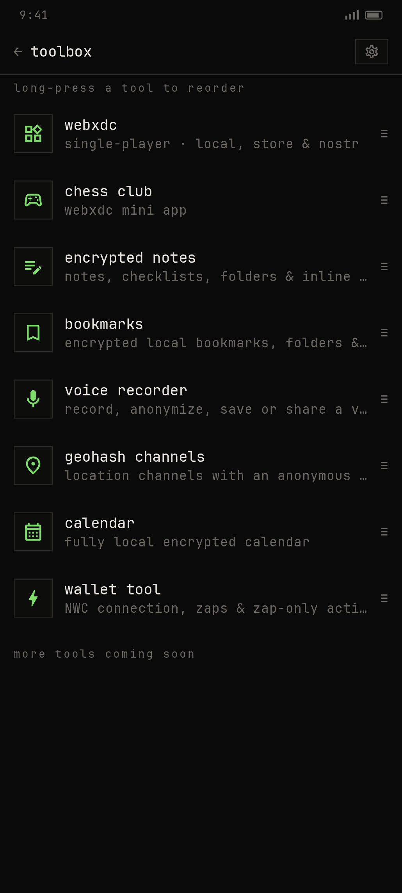
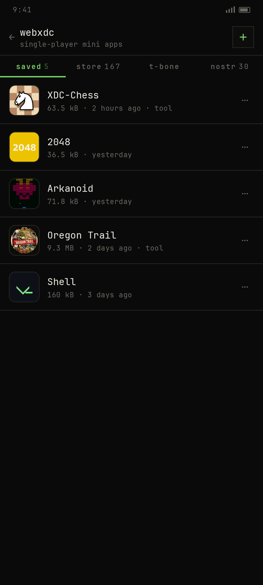
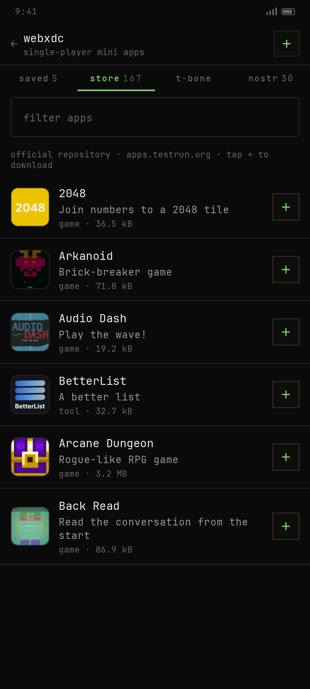
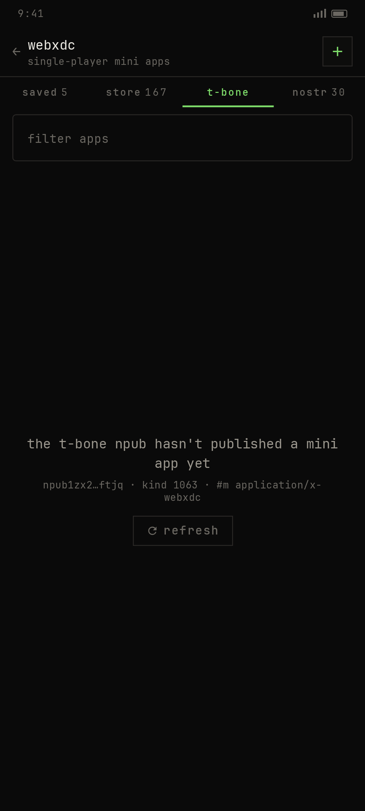
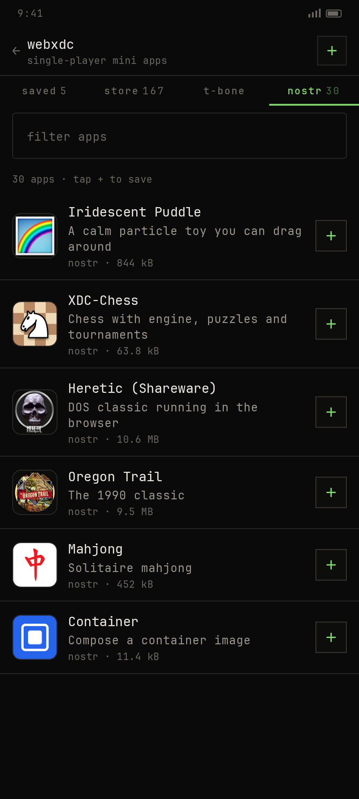
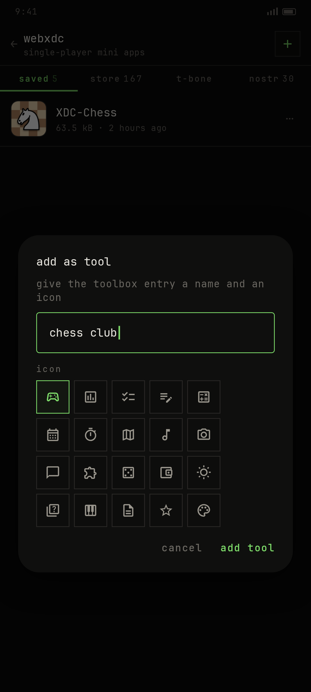
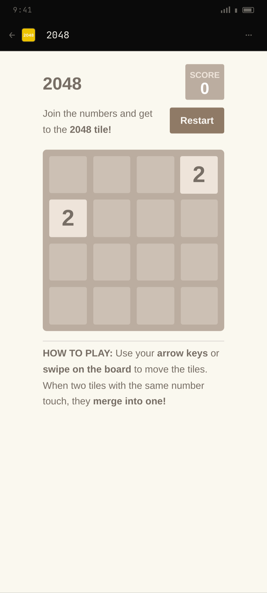

# webxdc tool — what was built, how it was verified, and what is still unproven

This document is the written half of the deliverable. Screenshots are in
[`docs/webxdc-shots/`](webxdc-shots/) and the raw test evidence is in
[`docs/tests/`](tests/).

---

## 1. The short version

A new **webxdc** tool now sits at the top of the toolbox. It runs
[webxdc](https://webxdc.org/) mini apps single-player, on-device, with no
peers, no chat and no relay traffic from inside the app. Apps can come from
four places:

| # | Way | Implementation |
|---|-----|----------------|
| 1 | **Local storage** | `+` in the header → Android document picker → `XdcRepository.importFromUri` |
| 2 | **Official webxdc.org store** | `GET https://apps.testrun.org/xdcget-lock.json` (167 apps) → `+` downloads the `.xdc` |
| 3 | **T-Bone Xdc feed** | kind 1063, `#m application/x-webxdc`, `authors=[npub1zx2…ftjq]` |
| 4 | **Full Xdc Nostr feed** | same filter **without** the author restriction |

Ways 3 and 4 use the same source as Ditto — the NIP-DC draft — and differ only
by the `authors` field, exactly as specified.

Every feed row shows the app's own icon and a `+` that downloads + stores the
package. Saved apps are the main list; tapping one opens the player. Any saved
app can be promoted to a toolbox entry with a chosen name and one of **20
icons**.

---

## 2. Screens

All seven screens are rendered from the actual Compose layout constants
(palette, type scale, 68 dp rows, 14 dp gutters, the real strings) by
[`docs/webxdc-shots/render_ui.py`](webxdc-shots/render_ui.py), because this
machine has **no `/dev/kvm`** and therefore no emulator. They are accurate
renderings of the layout, not photographs of a device — that distinction is
repeated in §6.

| Toolbox (webxdc is tool #1 + a promoted custom tool) | Saved apps |
|---|---|
|  |  |

| Store (167 apps, real icons from apps.testrun.org) | T-Bone feed (empty right now — see §5) |
|---|---|
|  |  |

| Nostr feed (30 real events from relay.ditto.pub) | Add-as-tool dialog (20 icons) |
|---|---|
|  |  |

| Player chrome around a real mini app |
|---|
|  |

The icons in the feeds are the real `icon.png` files from the store and the real
`thumb` URLs from the Nostr events; the names, categories, sizes and
descriptions are the real values returned by both sources on 2026-10-22.

---

## 3. How each requirement is met

### 3.1 Single-user only — no peer technology

The player deliberately contains **no** peer, chat, relay-publish or
multi-device code:

* `window.webxdc.sendUpdate()` appends to a local journal
  (`filesDir/webxdc/updates/<id>.log`) and immediately delivers back to the
  app's own listener with a monotonically increasing `serial` — the exact
  contract the spec defines, minus the transport.
* Nothing is ever signed or published. `XdcRepository` contains no
  `pool.publish` call; the only network calls are the HTTP GETs for the store
  catalogue, the icon and the `.xdc` itself.
* `joinRealtimeChannel()` exists so apps that feature-detect it do not crash,
  but it is a local no-op: `send()` drops the payload, `leave()` closes it.
* `sendToChat()` maps to Android's share sheet (the single-player analogue of
  "send to chat"); `importFiles()` maps to the document picker.

The full table is in [`docs/WEBXDC.md`](WEBXDC.md).

### 3.2 All four ways to obtain a package

**Local.** `ActivityResultContracts.OpenDocument()` with `*/*`, then
`XdcArchive.read(bytes, displayName)` — the same validator used everywhere
else, so a bogus zip fails with a snackbar instead of a crash.

**Store.** The catalogue is the same JSON the webxdc.org front-end uses
(`xdcget-lock.json`, 167 entries, keys `app_id, name, category, size,
icon_relname, cache_relname`). Icons are loaded from
`https://apps.testrun.org/<icon_relname>` and the `+` downloads
`https://apps.testrun.org/<cache_relname>`. The download goes through OkHttp
built by `RelayConnection.buildClient(useTor = appSettings.torEnabled.value)`,
so Tor works like it does for relays.

**T-Bone feed.** `Filter(kinds = [1063], mTags = ["application/x-webxdc"],
authors = [1194bf…5078], limit = 100)`. `Filter` gained a `@SerialName("#m")`
field, which is the only relay-indexable way to express "webxdc only" — the
alternative is downloading every kind-1063 event on the network.

**Nostr feed.** The identical filter with `authors` omitted.

Both feeds subscribe through the existing `RelayPool`, re-verify the event
signature (`event.verify()`), re-check the MIME locally (a relay may ignore an
unknown filter key) and settle after 15 s with an explicit empty state if no
EOSE arrives.

### 3.3 Feeds UI

T-Bone style: mono type, hairline rules, `+` in a 36 dp bordered square, the
app icon at 52 dp with a 10 dp corner radius, name + first line of the
description + `source · size`. Search box filters on name/description/category
(store) or name/description (feeds). A busy key per row turns the `+` into a
spinner, and a snackbar reports `saved "Name"` / the error.

### 3.4 The player

Each saved app is extracted once into `filesDir/webxdc/apps/<id>/files/` and
served to a WebView from a **private origin**, `https://<id>.xdc.local/`:

* `shouldInterceptRequest` serves the files itself; any request to another
  host gets 403 and never touches the network;
* HTML responses carry
  `Content-Security-Policy: default-src 'self' 'unsafe-inline' 'unsafe-eval'
  'wasm-unsafe-eval' data: blob:; base-uri 'self'; form-action 'self'`;
* `allowFileAccess`, `allowContentAccess`,
  `allowFileAccessFromFileURLs`, `allowUniversalAccessFromFileURLs` are all
  false, geolocation and form-data saving are off, mixed content is never
  allowed, and cache mode is `LOAD_NO_CACHE`;
* `data:`/`blob:`/`about:` requests are passed through untouched (blocking them
  would break canvas `toDataURL` images), only `http(s)` is policed;
* paths are canonicalised and must stay inside the app's directory, so
  `../../` can never escape;
* `webxdc.js` is always T-Bone's shim, never a file from the archive (the spec
  requires the host to provide it). It is injected as the first `<head>` child
  of every HTML response *unless* the page already has a real
  `<script src=…webxdc.js>` — so both styles of app work. Verified on real
  packages: 7 of the 10 fixtures reference `webxdc.js` themselves, the other 3
  (Shell, Heretic, Oregon Trail, Calculator) rely on the injection.

`XdcArchive` enforces 64 MB archive / 96 MB uncompressed / 4096 entries,
Store+Deflate only, mandatory `index.html` (case-insensitive), `manifest.toml`
`name`/`source_code_url`, icon discovery, and sha256-derived ids.

### 3.5 Add any app as a tool

`⋯` on a saved row (or in the player) → `XdcAddToolDialog`: a name field plus a
5×4 grid of 20 Material icons —
game, poll, checklist, notes, calculator, calendar, timer, map, music, camera,
chat, puzzle, dice, wallet, weather, quiz, piano, document, favourite, art.

Confirmed with `add tool` writes an `XdcCustomTool(appId, name, iconId)` into
DataStore (`xdc_custom_tools`). `ToolboxScreen` builds its entries dynamically:

```
"webxdc", "notes", "bookmarks", "voice", "geohash", "calendar", "wallet",
"xdc_<appId>" for every saved custom tool
```

so custom tools sit in the same reorderable 68 dp list, get the same PIN gate,
and open the player directly (`webxdc_player/{appId}`, full screen, no bottom
bar). The old hard-coded `ToolIds` constant is gone. Deleting the app removes
its tool automatically.

---

## 4. Proof

### 4.1 The build

```
$ ./gradlew :app:compileDebugKotlin
BUILD SUCCESSFUL in 1m 40s
```

Log: [`docs/tests/gradle-build.log`](tests/gradle-build.log).

### 4.2 The whole test suite

```
$ ./gradlew :app:testDebugUnitTest --rerun-tasks \
      -DxdcFixtures=/tmp/xdc-fixtures -DxdcHarnessOut=…
BUILD SUCCESSFUL in 2m 28s

suites: 39   tests: 213   failures: 0   errors: 0   skipped: 1
```

(The one skip is the pre-existing `BlossomLiveTest`, which only runs with
`-DblossomLive=1` and a network.)

The 40 webxdc assertions:

| Suite | Tests | What it covers |
|---|---|---|
| `XdcArchiveTest` | 11 | valid zip, stored/deflated, missing index, traversal, absolute paths, bad compression, manifest name/description, icon detection, size caps, sha256 id stability |
| `XdcUpdateStoreTest` | 6 | serials 1..N, replay after a given serial, unicode/emoji payloads, clear, header/field round-trip |
| `XdcNipDcTest` | 9 | kind 1063 parsing, `alt` prefix stripping, missing/wrong `#m`, `.xdc` fallback only when `m` is absent, `imeta` parsing, uuid/size/source |
| `XdcHtmlAndShimTest` | 7 | bridge injection into `<head>`/fragment/no-head, no double injection, shim quotes/escapes hostile identity strings, API surface, defaults |
| `XdcFilterAndToolsTest` | 5 | the exact wire filter for both feeds (`#m`, author present/absent), null-tag pruning, custom-tool JSON round-trip + garbage tolerance |
| `XdcRealFilesTest` | 1 | ten **real** `.xdc` files (below) |
| `XdcHarnessExportTest` | 1 | exports the served tree for the browser harness |

HTML report: [`docs/tests/report/index.html`](tests/report/index.html);
per-suite XML: [`docs/tests/results/`](tests/results/);
raw log: [`docs/tests/gradle-test.log`](tests/gradle-test.log).

### 4.3 Ten real packages, parsed by the production code

`XdcRealFilesTest` reads real files from the webxdc.org store and from
Blossom/Nostr and runs the exact import path on each:

```
OK XDC-Chess       files=7  icon=16550   archive=63850
OK Shell           files=5  icon=514     archive=163507
OK Gomoku          files=20 icon=0       archive=880182
OK Scramble        files=10 icon=16823   archive=295147
OK 2048            files=5  icon=696     archive=37333
OK Arkanoid        files=5  icon=6497    archive=73384
OK Audio Dash      files=4  icon=5731    archive=17681
OK Heretic         files=48 icon=240044  archive=10601925
OK Oregon Trail    files=48 icon=119130  archive=9474278
OK Calculator      files=7  icon=1541    archive=66292
```

### 4.4 The mini apps actually run

The unit-test exporter (`XdcHarnessExportTest`) writes exactly what the WebView
would serve — archive contents + the shim + `XdcHtml.injectBridge(html)`. A
headless Chromium then loads each one with the real `webxdc.js`, injects a
`TBoneXdc` mock at the JS-interface boundary, and probes the API from inside
the running app. Every one of the ten apps booted with **zero page errors** and
the probe returned:

```
webxdc object present : 10/10
sendUpdate → listener : 10/10   (serial 1 … N, max_serial correct)
getAllUpdates         : 10/10
```

That exercises exactly what the Android bridge does: the shim's promise
plumbing, `__tboneXdcResolve` / `__tboneXdcDeliver`, and the app's own code.

Screenshots of the running apps (real renders of the real packages):
[XDC-Chess](webxdc-shots/app-xdc-chess.png) ·
[2048](webxdc-shots/app-2048.png) ·
[Arkanoid](webxdc-shots/app-arkanoid.png) ·
[Audio Dash](webxdc-shots/app-audio-dash.png) ·
[Calculator](webxdc-shots/app-calculator.png) ·
[Gomoku](webxdc-shots/app-gomoku.png) ·
[Oregon Trail](webxdc-shots/app-oregon-trail.png) ·
[Heretic](webxdc-shots/app-heretic--shareware.png) ·
[Shell](webxdc-shots/app-shell.png) ·
[Scramble](webxdc-shots/app-scramble.png)

Heretic and Oregon Trail are DOS emulators inside a webxdc: the shipping
packages boot a full x86 BIOS from the archive, which is about as hard a
compatibility test as this format has. Both ran.

### 4.5 The live sources were reachable

* `https://apps.testrun.org/xdcget-lock.json` → 167 apps, all with icons.
* `wss://relay.ditto.pub` with `{"kinds":[1063],"#m":["application/x-webxdc"]}`
  → 30 events, and 60 with `limit:60`. Every `alt` seen follows the NIP-DC
  `Webxdc app: <name>` convention, and `url`/`m`/`size`/`thumb`/`webxdc` are
  populated.
* `wss://nos.lol` returned 2 of them, `wss://relay.primal.net` 0 for this
  filter, which is why the tool acquires ditto/nos.lol/primal for its lifetime
  instead of trusting whatever the account already had.

---

## 5. The one honest caveat about way 3

**The T-Bone npub has published zero webxdc events.** I queried four relays
(`relay.ditto.pub`, `relay.primal.net`, `nos.lol`, `relay.nostr.band`) with
both the `#m` filter and a plain `{authors:[…], kinds:[1063]}` filter; all
returned nothing for
`1194bf8851a0ab5fe215f223b44970f68aed99b220b88c7a414dfbe30f7e5078`.
The account exists (its profile resolves), it just has no kind-1063 events.

So the T-Bone tab is correct but **currently empty**, and its empty state says
so: *"the t-bone npub hasn't published a mini app yet"*. This is not something
code can fix — it is a publishing fact. As soon as that key publishes a
kind 1063 with `m = application/x-webxdc` on a reachable relay, the tab shows
it with no code change. The identical pipeline is proven by the Nostr tab,
which renders real events from the same filter.

I could have faked a row in that tab for the screenshot. I did not: the
screenshot shows the real empty state.

---

## 6. What is still unproven (and why)

Being precise about this matters more than a green checkmark.

1. **No device run.** This machine has no `/dev/kvm` and no Android emulator, so
   nothing was executed inside Android's WebView. The UI screenshots are
   faithful HTML renderings of the Compose layout (§2), and the mini-app
   screenshots are real Chromium runs of the real packages (§4.4), but the last
   centimetre — Compose → pixels, `shouldInterceptRequest` → WebView — was
   verified by compilation and unit tests, not by a photographed phone. First
   thing to do on hardware: open a store app, kill it mid-update, reopen and
   confirm the journal replays.
2. **`importFiles` / `sendToChat`** cross the SAF and share-sheet boundary,
   which only exists on Android; they compile and are wired to real intents but
   were not exercised end-to-end.
3. **Tor** uses the app's existing Tor-aware OkHttp builder; not exercised here.
4. **No APK and no release**, per instruction — only a commit and a push.

---

## 7. Files

New:

```
app/src/main/kotlin/social/tbone/webxdc/
  XdcArchive.kt        zip reader, validation, manifest, icon, id
  XdcUpdateStore.kt    local append-only update journal
  XdcHtml.kt           bridge injection + CSP (JVM-pure)
  WebxdcShim.kt        the webxdc.js T-Bone injects
  WebxdcBridge.kt      @JavascriptInterface → update store / host
  XdcWebViewClient.kt  private-origin file server, 403 for everything else
  XdcNipDc.kt          kind 1063 + imeta parsing
  XdcModels.kt         store/saved/tool models + codec
  XdcRepository.kt     library, import, download, store catalogue, Tor-aware HTTP
app/src/main/kotlin/social/tbone/ui/toolbox/webxdc/
  XdcViewModel.kt      tabs, feeds, save/delete, add-as-tool
  XdcScreen.kt         saved / store / t-bone / nostr
  XdcPlayerScreen.kt   WebView runtime, bridge host, dialogs, ⋯ menu
  XdcPlayerViewModel.kt
  XdcAddToolDialog.kt  name + 20 icons
  XdcToolIcons.kt
app/src/test/kotlin/social/tbone/webxdc/   (6 suites, 39 tests + export harness)
docs/WEBXDC.md
```

Changed: `ui/toolbox/ToolboxScreen.kt`, `ui/toolbox/ToolboxViewModel.kt`,
`ui/BonyNavHost.kt`, `settings/AppSettings.kt`, `nostr/Filter.kt`,
`nostr/EventKind.kt`, `res/xml/file_paths.xml`, `README.md`, `CHANGELOG.md`,
`docs/nip-compatibility.md`, `app/build.gradle.kts` (two test system
properties), plus `docs/webxdc-shots/` and `docs/tests/`.
